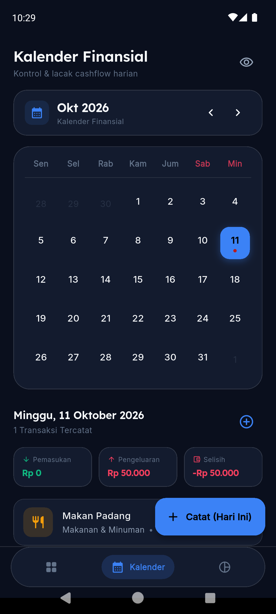
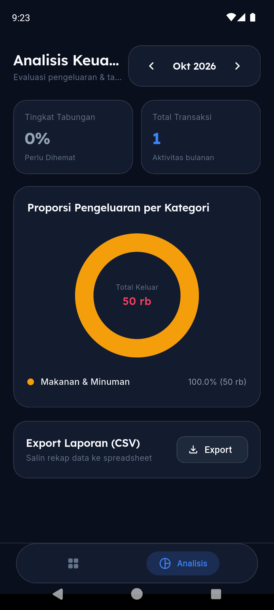
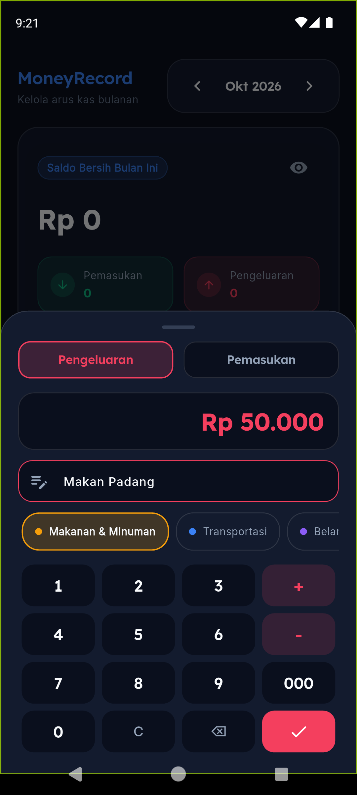
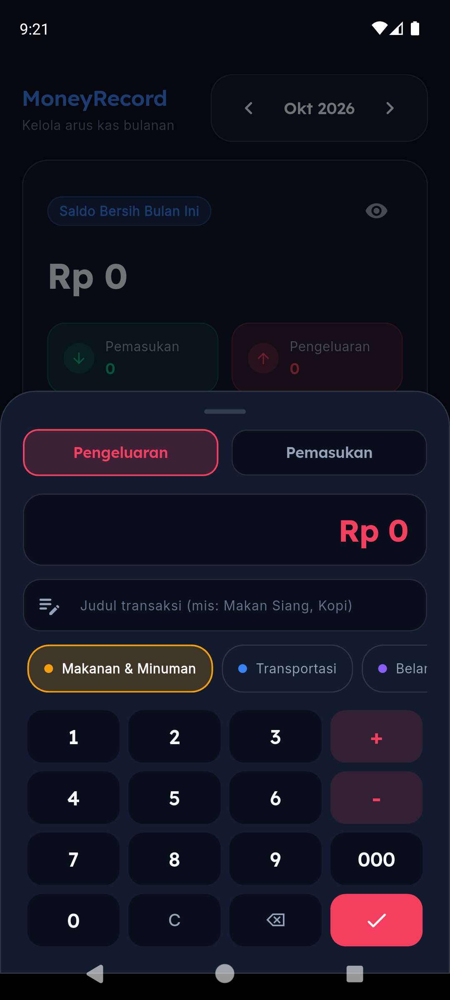

# MoneyRecord — Modern Offline-First Personal Finance Tracker

<div align="center">


-003B57?style=for-the-badge&logo=sqlite)


<p align="center">
  A high-performance, privacy-centric personal expense tracker engineered with <b>Flutter Clean Architecture</b>, <b>Reactive SQLite WAL Engine</b>, custom <b>Shunting-Yard Math Parser</b>, and a modern <b>Dark Glassmorphic Bento Grid UI</b>.
</p>

</div>

---

## 📱 Visual Showcase & Screenshots

| 1. Dashboard & Cashflow Trend | 2. Analytics & Category Donut | 3. Financial Expression Keypad | 4. Quick Category Selection |
| :---: | :---: | :---: | :---: |
|  |  |  |  |

---

## 🚀 Fitur Unggulan & Kompleksitas Teknis

### 1. In-App Expression Evaluator (Shunting-Yard Algorithm)
Alih-alih menggunakan keyboard default sistem yang lambat atau library pihak ketiga, MoneyRecord menyematkan **Keypad Finansial Kustom** dengan implementasi murni algoritma *Dijkstra's Shunting-Yard*:
* **Real-time Evaluation:** Mendukung penulisan ekspresi aritmatika langsung di kolom nominal (contoh: `15000 + 25000 * 2`).
* **Operator Precedence & Associativity:** Mendukung tanda kurung `()`, perkalian `*`, pembagian `/`, penjumlahan `+`, pengurangan `-`, serta angka desimal.
* **Safety Guards:** Proteksi pembagian nol (*division by zero*), auto-recovery dari ekspresi yang belum selesai (*incomplete input*), dan haptic feedback saat ditekan.

### 2. Reactive Offline-First SQLite Engine (WAL Mode)
* **Write-Ahead Logging (WAL):** Memaksimalkan konkurensi pembacaan data tanpa terblokir saat transaksi penulisan berlangsung.
* **Foreign Key Constraints & Indexing:** Indeks komposit pada kolom `date` dan `category_id` untuk memastikan eksekusi *range query* bulanan di bawah 5 ms.
* **Reactive Stream Architecture:** `StreamController.broadcast()` memancarkan perubahan tabel secara instan ke seluruh antarmuka pengguna tanpa *loading spinner* manual.

### 3. Visualisasi Data Finansial Interaktif
* **Cashflow Spline Chart:** Grafik kurva tren pengeluaran harian sepanjang bulan berjalan dengan *smooth gradient fill* dan *touch tooltip inspection*.
* **Interactive Category Donut:** Visualisasi proporsi pengeluaran dengan lubang tengah dinamis yang merespons sentuhan segmen kategori untuk inspeksi detail.
* **Monthly KPI Summary:** Kartu metrik tingkat tabungan (*savings rate*), total transaksi bulanan, dan indikator kesehatan finansial.

### 4. Standar Desain Finansial Modern (WCAG AA Compliant)
* **Dark Glassmorphic & Bento Grid:** Menggunakan palet *Dark Slate* (`#0A0F1D`), *Emerald* (`#10B981`), dan *Rose Accent* (`#F43F5E`) dengan kontras tinggi.
* **Tipografi Finansial:** Menggunakan font **Lexend** (dioptimalkan untuk angka finansial) dipadukan dengan **Inter**.
* **Privacy Masking:** Fitur toggle mata untuk menyamarkan saldo (`••••••••`) saat berada di tempat umum.
* **Ekspor Laporan (CSV):** Kemampuan mengekspor rekap mutasi bulanan ke clipboard/file CSV untuk kebutuhan spreadsheet.

---

## 🏛️ Arsitektur Proyek (Clean Architecture)

Mengikuti prinsip pemisahan tanggung jawab (*Separation of Concerns*) dan *SOLID Principles*:

```
lib/
├── core/
│   ├── constants/            # Design tokens: AppColors, AppTypography
│   ├── database/             # SQLite Helper, WAL config, indexing, schema migration
│   ├── math/                 # Custom Shunting-Yard arithmetic expression evaluator
│   └── utils/                # CurrencyFormatter (IDR), DateUtils (relative dates)
├── features/
│   ├── categories/           # Category Domain, Data, & Seed Repository
│   ├── transactions/         # Transactions Feature:
│   │   ├── domain/           # Entities (Transaction, MonthlySummary) & UseCases
│   │   ├── data/             # Models & TransactionRepositoryImpl (Reactive Streams)
│   │   └── presentation/     # BLoC, BalanceHeroCard, SplineChart, NumpadSheet
│   ├── analytics/            # Analytics Feature: Donut Chart, KPI cards, CSV Export
│   └── navigation/           # MainNavigationScaffold (Modern pill navigation bar)
├── injection_container.dart  # Dependency Injection via GetIt
└── main.dart                 # Application entry point & Indonesian locale initialization
```

---

## 🧪 Pengujian & Kualitas Kode (Testing Suite)

Proyek ini dilengkapi dengan 12 test otomatis yang mencakup Unit Test logika algoritma, Domain UseCase, dan Widget Test:

```bash
# Menjalankan seluruh test suite
flutter test

# Memeriksa static analysis & zero warning
flutter analyze

# Memeriksa code formatting
dart format --output=none --set-exit-if-changed .
```

---

## 📦 Ukuran APK & Optimasi Build

| Target Build | File APK | Ukuran |
| :--- | :--- | :--- |
| **Release (Modern 64-bit Android)** | `app-arm64-v8a-release.apk` | **20.2 MB** |
| **Release (Legacy 32-bit Android)** | `app-armeabi-v7a-release.apk` | **17.6 MB** |
| **Release (Emulator x86_64)** | `app-x86_64-release.apk` | **21.6 MB** |
| *Play Store App Bundle (.aab)* | *Dynamic Delivery* | *~12–15 MB* |

Untuk membuat APK Release:
```bash
flutter build apk --split-per-abi
```

---

## 💻 Panduan Instalasi Lokal

1. **Clone repository ini:**
   ```bash
   git clone https://github.com/rafliadipratama/money_record.git
   cd money_record
   ```

2. **Pasang seluruh dependensi:**
   ```bash
   flutter pub get
   ```

3. **Jalankan aplikasi di perangkat Android / Emulator:**
   ```bash
   flutter run
   ```

---

## 📄 Lisensi

Didistribusikan di bawah lisensi **MIT License**. Lihat file [`LICENSE`](LICENSE) untuk informasi lebih lanjut.
